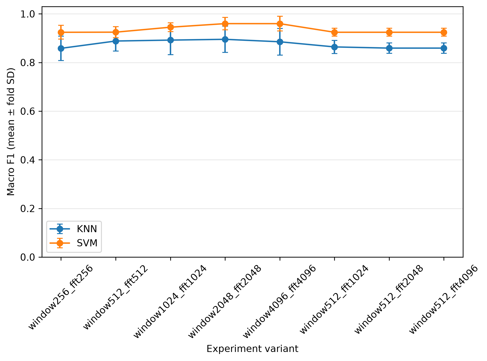
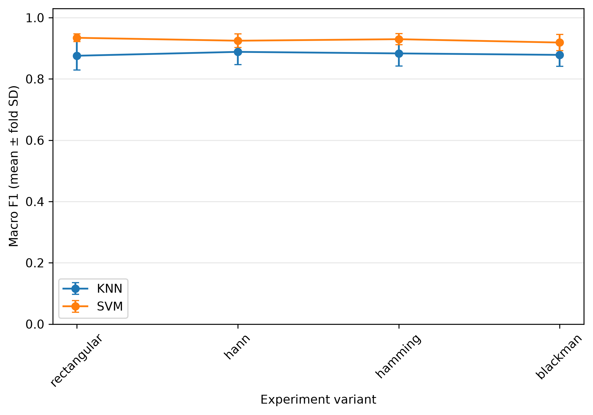
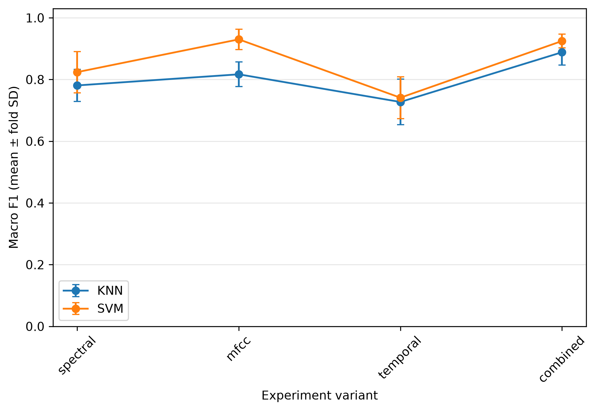
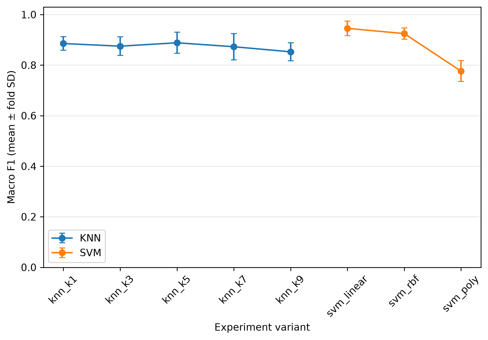
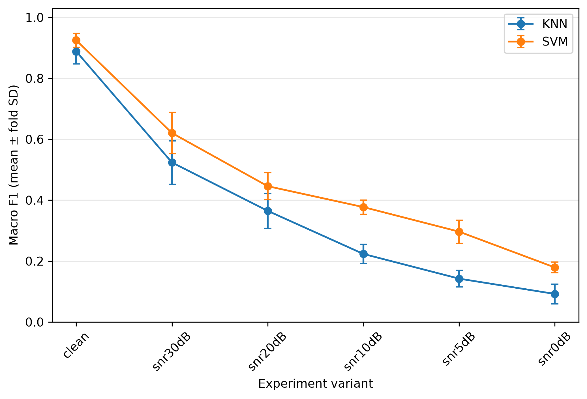
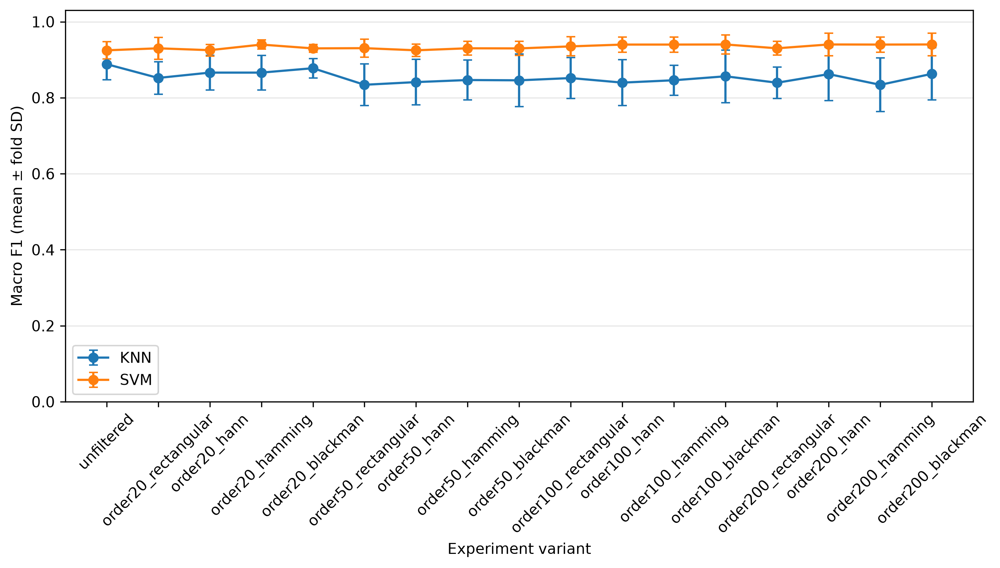

# Verified SoundSense results

These values are computed from saved held-out predictions on the five-class ESC-50 subset. Synthetic test scores are excluded.

## Nested baseline

| Model | Accuracy mean ± SD | Macro F1 | Mean fit/search (s) | Predict (ms/clip) |
| --- | --- | --- | --- | --- |
| KNN | 87.50% ± 2.74 pp | 0.8748 | 0.1604 | 0.0724 |
| SVM | 94.50% ± 1.87 pp | 0.9452 | 0.3194 | 0.0164 |

Each outer fold holds out 40 clips; the other 160 supply four inner folds for parameter search. Deployment models are separate all-data refits. The standard deviation is across folds with ddof=0.

## Six fixed-parameter studies

### Window Length

| variant | algorithm | accuracy_mean | accuracy_std | f1_macro_mean |
| --- | --- | --- | --- | --- |
| window256_fft256 | knn | 0.8600 | 0.0464 | 0.8583 |
| window256_fft256 | svm | 0.9250 | 0.0274 | 0.9243 |
| window512_fft512 | knn | 0.8900 | 0.0406 | 0.8884 |
| window512_fft512 | svm | 0.9250 | 0.0224 | 0.9248 |
| window1024_fft1024 | knn | 0.8950 | 0.0557 | 0.8922 |
| window1024_fft1024 | svm | 0.9450 | 0.0187 | 0.9452 |
| window2048_fft2048 | knn | 0.9000 | 0.0500 | 0.8954 |
| window2048_fft2048 | svm | 0.9600 | 0.0255 | 0.9599 |
| window4096_fft4096 | knn | 0.8900 | 0.0515 | 0.8853 |
| window4096_fft4096 | svm | 0.9600 | 0.0300 | 0.9598 |
| window512_fft1024 | knn | 0.8650 | 0.0255 | 0.8641 |
| window512_fft1024 | svm | 0.9250 | 0.0158 | 0.9244 |
| window512_fft2048 | knn | 0.8600 | 0.0200 | 0.8592 |
| window512_fft2048 | svm | 0.9250 | 0.0158 | 0.9244 |
| window512_fft4096 | knn | 0.8600 | 0.0200 | 0.8592 |
| window512_fft4096 | svm | 0.9250 | 0.0158 | 0.9244 |

### Window Comparison

| variant | algorithm | accuracy_mean | accuracy_std | f1_macro_mean |
| --- | --- | --- | --- | --- |
| rectangular | knn | 0.8800 | 0.0430 | 0.8758 |
| rectangular | svm | 0.9350 | 0.0122 | 0.9343 |
| hann | knn | 0.8900 | 0.0406 | 0.8884 |
| hann | svm | 0.9250 | 0.0224 | 0.9248 |
| hamming | knn | 0.8850 | 0.0406 | 0.8834 |
| hamming | svm | 0.9300 | 0.0187 | 0.9298 |
| blackman | knn | 0.8800 | 0.0367 | 0.8785 |
| blackman | svm | 0.9200 | 0.0245 | 0.9188 |

### Feature Comparison

| variant | algorithm | accuracy_mean | accuracy_std | f1_macro_mean |
| --- | --- | --- | --- | --- |
| spectral | knn | 0.7800 | 0.0510 | 0.7809 |
| spectral | svm | 0.8250 | 0.0652 | 0.8240 |
| mfcc | knn | 0.8250 | 0.0387 | 0.8169 |
| mfcc | svm | 0.9300 | 0.0332 | 0.9302 |
| temporal | knn | 0.7250 | 0.0758 | 0.7273 |
| temporal | svm | 0.7450 | 0.0660 | 0.7411 |
| combined | knn | 0.8900 | 0.0406 | 0.8884 |
| combined | svm | 0.9250 | 0.0224 | 0.9248 |

### Classifier Comparison

| variant | algorithm | accuracy_mean | accuracy_std | f1_macro_mean |
| --- | --- | --- | --- | --- |
| knn_k1 | knn | 0.8850 | 0.0255 | 0.8854 |
| knn_k3 | knn | 0.8750 | 0.0354 | 0.8750 |
| knn_k5 | knn | 0.8900 | 0.0406 | 0.8884 |
| knn_k7 | knn | 0.8750 | 0.0500 | 0.8727 |
| knn_k9 | knn | 0.8550 | 0.0332 | 0.8527 |
| svm_linear | svm | 0.9450 | 0.0292 | 0.9455 |
| svm_rbf | svm | 0.9250 | 0.0224 | 0.9248 |
| svm_poly | svm | 0.7650 | 0.0464 | 0.7764 |

### Noise Robustness

| variant | algorithm | accuracy_mean | accuracy_std | f1_macro_mean |
| --- | --- | --- | --- | --- |
| clean | knn | 0.8900 | 0.0406 | 0.8884 |
| clean | svm | 0.9250 | 0.0224 | 0.9248 |
| snr30dB | knn | 0.5650 | 0.0515 | 0.5237 |
| snr30dB | svm | 0.6700 | 0.0557 | 0.6205 |
| snr20dB | knn | 0.4600 | 0.0539 | 0.3650 |
| snr20dB | svm | 0.5650 | 0.0255 | 0.4460 |
| snr10dB | knn | 0.3500 | 0.0274 | 0.2235 |
| snr10dB | svm | 0.5000 | 0.0274 | 0.3773 |
| snr5dB | knn | 0.2550 | 0.0187 | 0.1424 |
| snr5dB | svm | 0.3950 | 0.0292 | 0.2967 |
| snr0dB | knn | 0.2150 | 0.0200 | 0.0923 |
| snr0dB | svm | 0.2750 | 0.0158 | 0.1792 |

### Filter Comparison

| variant | algorithm | accuracy_mean | accuracy_std | f1_macro_mean |
| --- | --- | --- | --- | --- |
| unfiltered | knn | 0.8900 | 0.0406 | 0.8884 |
| unfiltered | svm | 0.9250 | 0.0224 | 0.9248 |
| order20_rectangular | knn | 0.8550 | 0.0400 | 0.8521 |
| order20_rectangular | svm | 0.9300 | 0.0292 | 0.9301 |
| order20_hann | knn | 0.8700 | 0.0430 | 0.8661 |
| order20_hann | svm | 0.9250 | 0.0158 | 0.9252 |
| order20_hamming | knn | 0.8700 | 0.0430 | 0.8661 |
| order20_hamming | svm | 0.9400 | 0.0122 | 0.9399 |
| order20_blackman | knn | 0.8800 | 0.0245 | 0.8777 |
| order20_blackman | svm | 0.9300 | 0.0100 | 0.9299 |
| order50_rectangular | knn | 0.8400 | 0.0490 | 0.8341 |
| order50_rectangular | svm | 0.9300 | 0.0245 | 0.9305 |
| order50_hann | knn | 0.8450 | 0.0579 | 0.8412 |
| order50_hann | svm | 0.9250 | 0.0158 | 0.9248 |
| order50_hamming | knn | 0.8500 | 0.0500 | 0.8466 |
| order50_hamming | svm | 0.9300 | 0.0187 | 0.9301 |
| order50_blackman | knn | 0.8500 | 0.0652 | 0.8458 |
| order50_blackman | svm | 0.9300 | 0.0187 | 0.9298 |
| order100_rectangular | knn | 0.8550 | 0.0485 | 0.8518 |
| order100_rectangular | svm | 0.9350 | 0.0255 | 0.9352 |
| order100_hann | knn | 0.8450 | 0.0557 | 0.8398 |
| order100_hann | svm | 0.9400 | 0.0200 | 0.9399 |
| order100_hamming | knn | 0.8500 | 0.0354 | 0.8460 |
| order100_hamming | svm | 0.9400 | 0.0200 | 0.9399 |
| order100_blackman | knn | 0.8600 | 0.0644 | 0.8564 |
| order100_blackman | svm | 0.9400 | 0.0255 | 0.9401 |
| order200_rectangular | knn | 0.8450 | 0.0367 | 0.8395 |
| order200_rectangular | svm | 0.9300 | 0.0187 | 0.9301 |
| order200_hann | knn | 0.8650 | 0.0644 | 0.8622 |
| order200_hann | svm | 0.9400 | 0.0300 | 0.9402 |
| order200_hamming | knn | 0.8400 | 0.0644 | 0.8340 |
| order200_hamming | svm | 0.9400 | 0.0200 | 0.9399 |
| order200_blackman | knn | 0.8650 | 0.0644 | 0.8629 |
| order200_blackman | svm | 0.9400 | 0.0300 | 0.9402 |

## Interpretation and limits

The feature study's largest observed macro F1 is mfcc / SVM = 0.9302. All window/feature/filter comparisons are exploratory on shared folds, not independent confirmation of a selected winner.

Noise robustness: KNN: clean 89.0%, 30 dB 56.5%, 0 dB 21.5% accuracy. SVM: clean 92.5%, 30 dB 67.0%, 0 dB 27.5% accuracy. Noise augmentation or robust feature design would require a separate leakage-safe study.

Audited 88 evaluated configurations, each with 200 held-out predictions and five split audits. All confusion matrices and per-fold accuracies agree with the saved predictions. Verified 1,000 noisy recordings; maximum requested/measured SNR difference: 4.44e-15 dB.

Model/feature inference times exclude WAV decoding and DSP. All results apply to only five ESC-50 classes. No independent external deployment dataset, simultaneous-event labeling or open-set rejection was evaluated.
